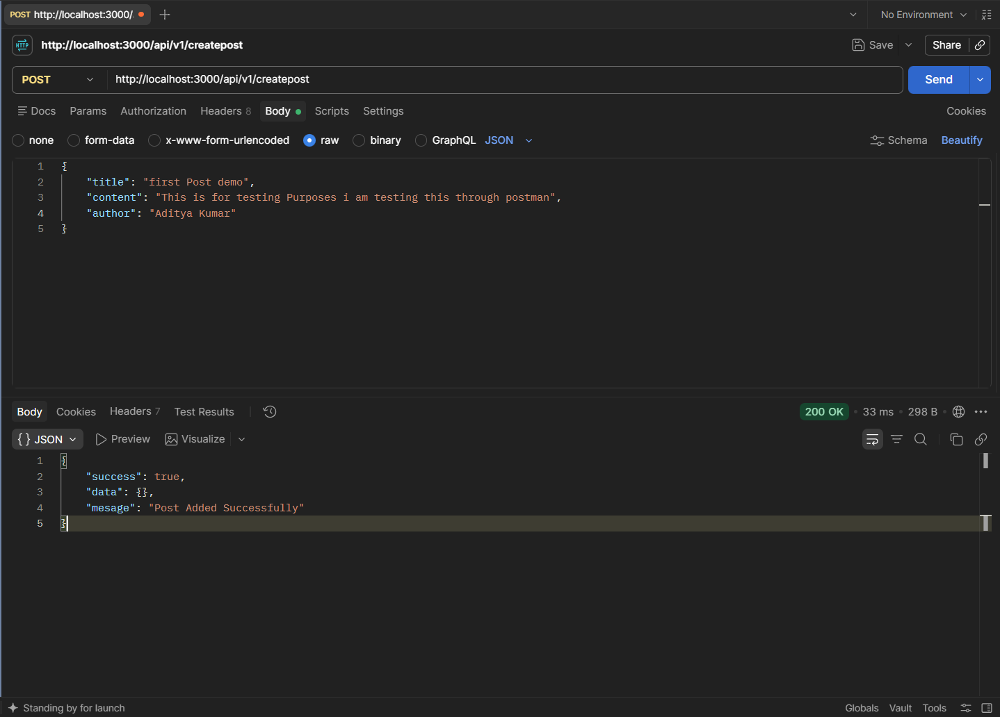
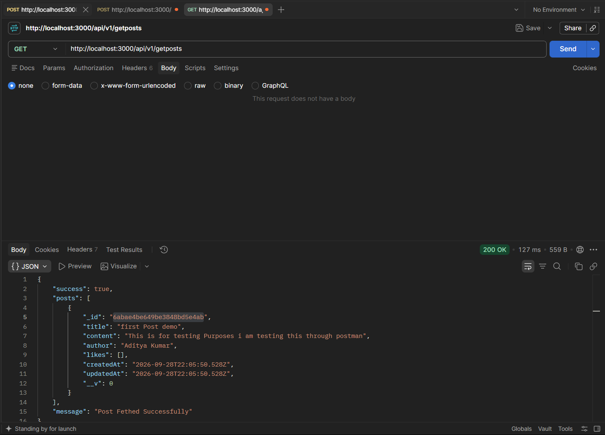
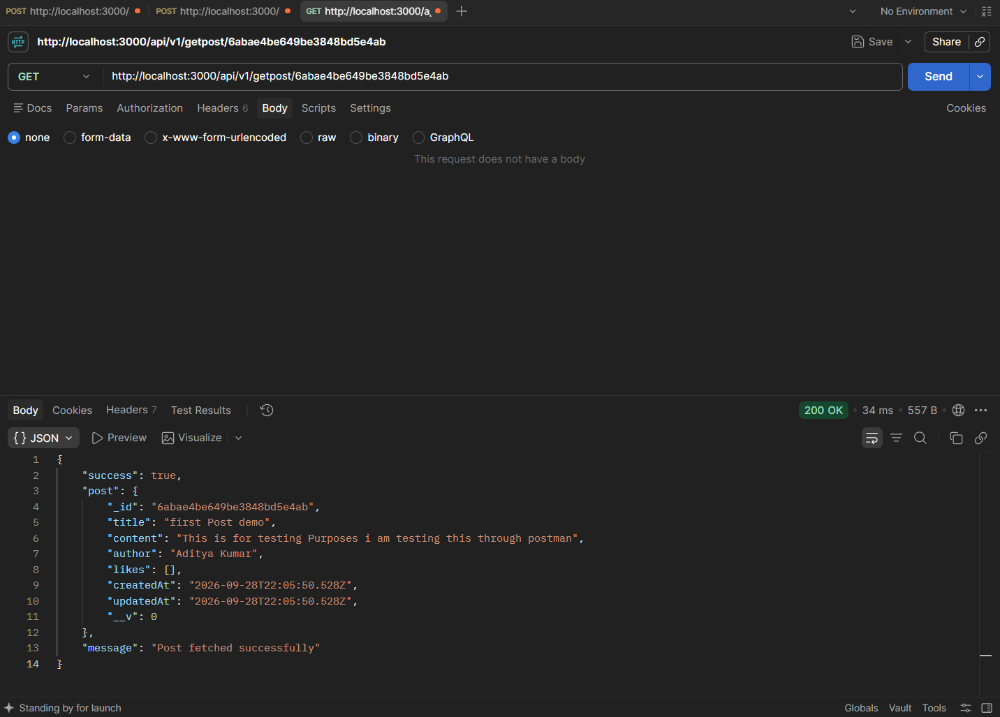
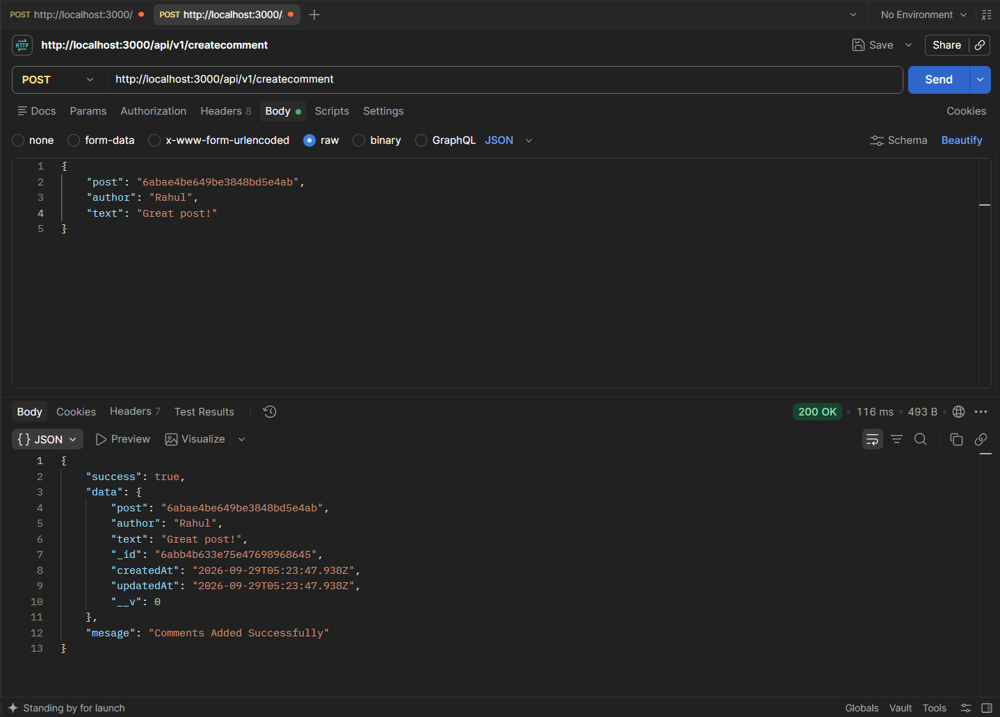
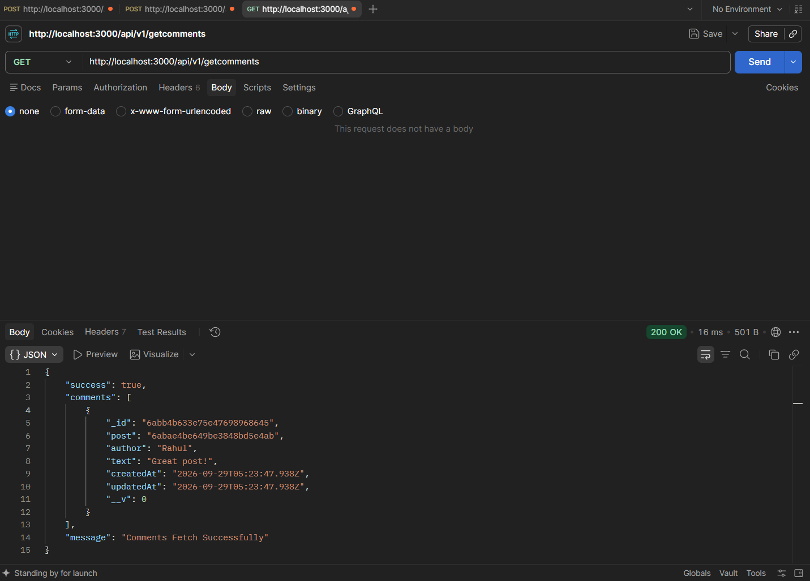
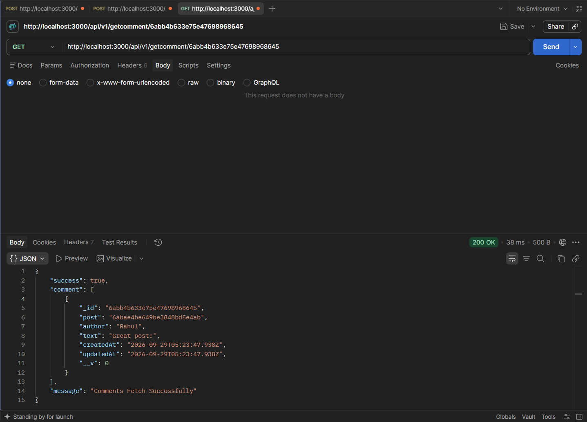
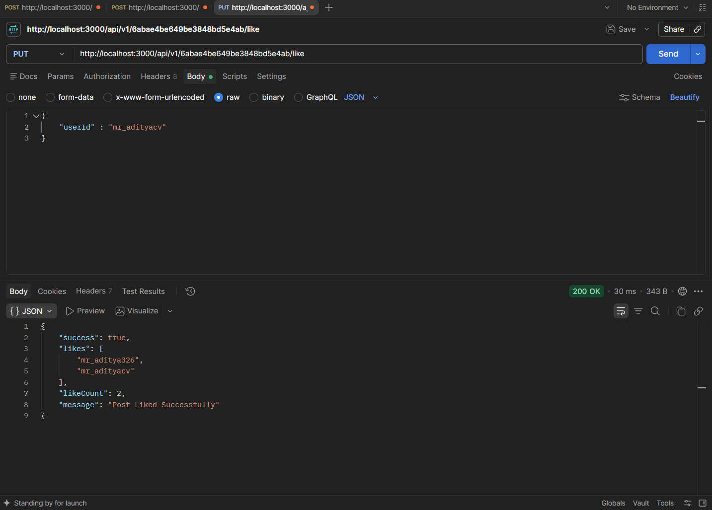
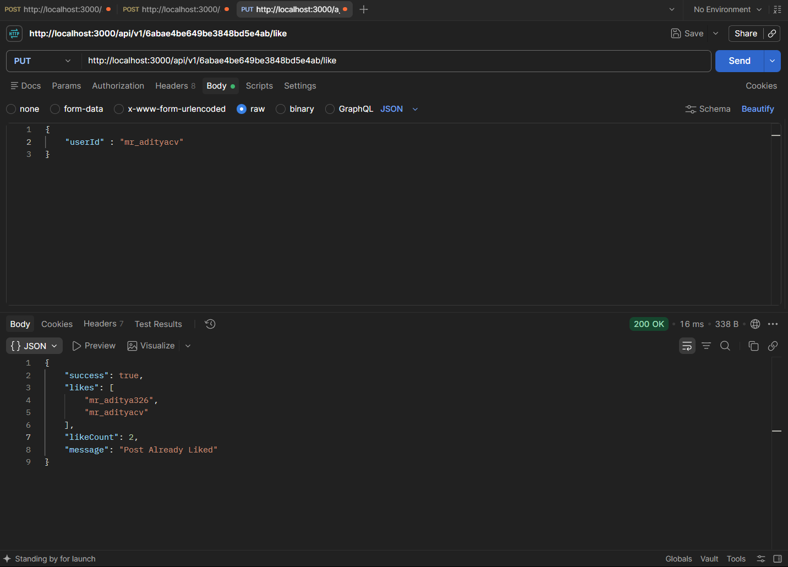
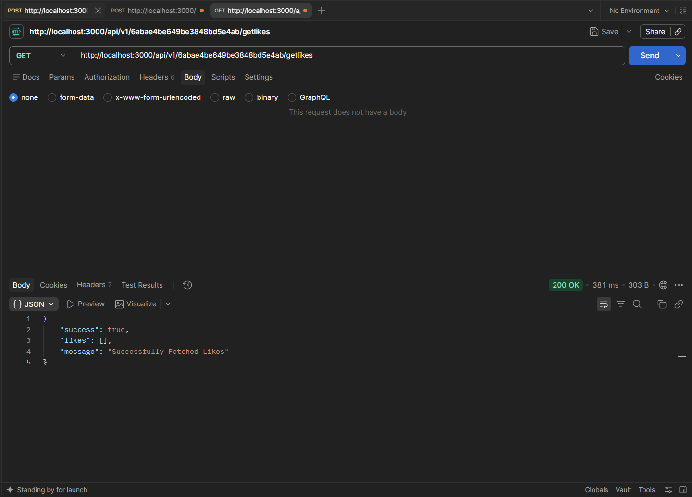
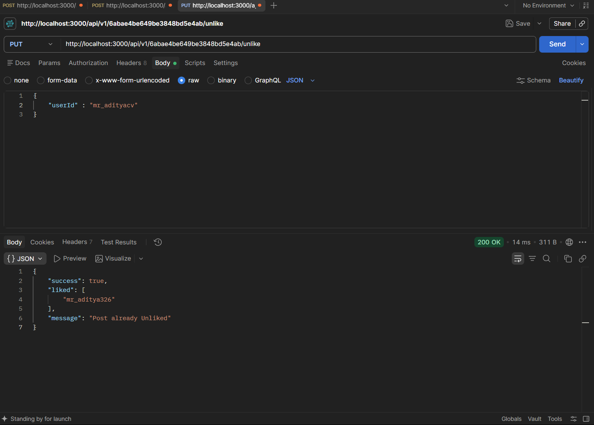

# Blog Backend Notes

This project is a simple blog backend made with Node.js, Express, and MongoDB using Mongoose. These notes explain the folder structure, database schemas, controllers, routes, request bodies, responses, and the main concepts used in the project.

Use this file for revision before class, practical work, or interviews.

## 1. Technologies Used

- Node.js: JavaScript runtime for the backend
- Express.js: framework for creating the server and API routes
- MongoDB: database for storing posts and comments
- Mongoose: library for creating schemas and communicating with MongoDB
- dotenv: loads values from the `.env` file
- nodemon: restarts the server when files change during development

## 2. How to Run the Project

Install the dependencies:

```bash
npm install
```

Create a `.env` file in the project root:

```env
DB_URL=mongodb://127.0.0.1:27017/blog-hw
PORT=4000
```

Start the development server:

```bash
npm run dev
```

The server should run at:

```text
http://localhost:4000
```

The root test endpoint is:

```http
GET /
```

Expected response:

```text
Working Fine
```

## 3. Folder Structure

```text
blog-hw/
├── config/
│   └── dbConnect.js
├── controller/
│   ├── createComments.js
│   ├── createPost.js
│   ├── getComments.js
│   ├── getLikes.js
│   ├── getPost.js
│   └── updateLikes.js
├── model/
│   ├── commentSchema.js
│   └── postSchema.js
├── public/
│   ├── createComments.png
│   ├── createPost.png
│   ├── getAllComments.png
│   ├── getallPost.png
│   ├── getAsingleComment.png
│   ├── getLikes.png
│   ├── getPostById.png
│   ├── likedPostAlready.png
│   ├── likePost.png
│   ├── unlikedPostAlready.png
│   └── unlikePost.png
├── routes/
│   ├── commentsRoutes.js
│   ├── likesRoutes.js
│   └── postRoutes.js
├── .env
├── .gitignore
├── package.json
├── README.md
└── server.js
```

### Responsibility of each folder

- `config/`: database connection code
- `model/`: Mongoose schemas and models
- `controller/`: business logic for each operation
- `routes/`: URL paths and HTTP methods
- `public/`: screenshots and static project images
- `server.js`: creates the Express app, registers middleware, connects routes, and starts the server

## 4. Request Flow

The request flow is:

```text
Client/Postman
			|
			v
Route file
			|
			v
Controller function
			|
			v
Mongoose model
			|
			v
MongoDB
```

Example:

```text
POST /api/v1/createpost
				|
				v
postRoutes.js
				|
				v
createPost.js
				|
				v
postSchema.js
				|
				v
Posts collection
```

## 5. Database Schemas

### Post schema

The post document contains:

```js
{
		title: String,
		content: String,
		author: String,
		likes: [String],
		createdAt: Date,
		updatedAt: Date
}
```

`likes` stores the IDs or usernames of users who liked the post.

Example document:

```json
{
	"title": "Learning Express",
	"content": "Express is used to create APIs in Node.js.",
	"author": "aditya",
	"likes": ["user101", "user202"]
}
```

The number of likes is calculated with:

```js
post.likes.length
```

### Comment schema

The comment document contains:

```js
{
		post: ObjectId,
		author: String,
		text: String,
		createdAt: Date,
		updatedAt: Date
}
```

The `post` field stores the ID of the post to which the comment belongs. The `ref: 'Posts'` option tells Mongoose that this ID refers to the Posts model.

## 6. API Base URL

All route files are mounted in `server.js` with this prefix:

```text
/api/v1
```

Therefore, the route path written in a route file is combined with `/api/v1`.

For example:

```js
router.post('/createpost', createPost);
```

Becomes:

```text
POST /api/v1/createpost
```

## 7. Post Routes

### Create a post

```http
POST /api/v1/createpost
```

Request body:

```json
{
	"title": "My first blog post",
	"content": "This is the content of my blog post.",
	"author": "aditya"
}
```

Controller: `controller/createPost.js`

### Get all posts

```http
GET /api/v1/getposts
```

This returns all documents from the Posts collection.

Controller: `controller/getPost.js`

### Get one post by ID

```http
GET /api/v1/getpost/:id
```

Example:

```text
GET /api/v1/getpost/65f123456789abcdef123456
```

Controller: `controller/getPost.js`

## 8. Comment Routes

### Create a comment

```http
POST /api/v1/createcomment
```

Request body:

```json
{
	"post": "65f123456789abcdef123456",
	"author": "rahul",
	"text": "This is a useful post."
}
```

Controller: `controller/createComments.js`

### Get all comments

```http
GET /api/v1/getcomments
```

Controller: `controller/getComments.js`

### Get one comment by ID

```http
GET /api/v1/getcomment/:id
```

Example:

```text
GET /api/v1/getcomment/65f123456789abcdef123456
```

Controller: `controller/getComments.js`

## 9. Like Routes

The current project uses `PUT` for like and unlike operations.

### Like a post

```http
PUT /api/v1/:id/like
```

Request body:

```json
{
	"userId": "user101"
}
```

The controller checks whether the user has already liked the post. If not, the user ID is added to the `likes` array.

### Unlike a post

```http
PUT /api/v1/:id/unlike
```

Request body:

```json
{
	"userId": "user101"
}
```

The controller removes that user ID from the `likes` array.

### Get likes for a post

```http
GET /api/v1/:id/getlikes
```

This returns the users who liked the post.

### Like rules

- One user should be counted only once per post.
- Like should add the user ID only if it does not already exist.
- Unlike should remove only the matching user ID.
- `likeCount` is calculated with `likes.length`.
- In a real application, `userId` should come from authentication instead of being sent freely by the client.

## 10. Important Express Concepts

### `express.json()`

This middleware allows Express to read JSON request bodies:

```js
app.use(express.json());
```

Without it, `req.body` may be undefined for JSON requests.

### `express.Router()`

Router files keep related endpoints together:

```js
const router = express.Router();
```

The router is exported and mounted in `server.js`.

### Route parameters

In this route:

```js
router.get('/getpost/:id', getPostById);
```

The value is read with:

```js
const id = req.params.id;
```

### Request body

JSON data sent by the client is read with:

```js
const { title, content, author } = req.body;
```

### HTTP status codes used

- `200`: request completed successfully
- `404`: requested post, comment, or data was not found
- `500`: unexpected server or database error

## 11. Mongoose Concepts

### Schema

A schema describes the shape and rules of a MongoDB document.

### Model

A model is created from a schema and is used to query a collection:

```js
const Posts = mongoose.model('Posts', postSchema);
```

### Create data

```js
const response = await Posts.create({ title, content, author });
```

### Find all data

```js
const response = await Posts.find({});
```

### Find by ID

```js
const response = await Posts.findById({ _id: id });
```

### Update data

```js
const updatedPost = await Posts.findByIdAndUpdate(
		{ _id: id },
		{ likes: newLikes },
		{ new: true }
);
```

`new: true` returns the updated document instead of the old document.

## 12. Images and Screenshots

The screenshots are stored in `public/` and can be viewed from this README:

### Create post



### Get all posts



### Get post by ID



### Create comment



### Get all comments



### Get one comment



### Like post



### Already liked post



### Get likes



### Unlike post


### Already unliked post



## 13. Important Corrections to Remember

Before treating this project as finished, check these points:

1. In Mongoose fields, the correct option is `required: true`, not `require: true`. The current schemas use `require`, so required validation will not work until it is corrected.
2. Make sure `server.js` imports the route files and mounts them with `app.use()`.
3. Make sure the database connection is called after the server starts or before accepting requests.
4. Validate that a `post` ID exists before creating a comment.
5. Validate that `userId` is present before like or unlike operations.
6. Validate MongoDB IDs before calling `findById()` to return a clean error for invalid IDs.
7. For concurrent requests, `$addToSet` is safer than reading the likes array and manually replacing it. `$addToSet` prevents duplicate values.
8. Keep `.env` in `.gitignore` so the database URL is not uploaded to GitHub.
9. In a production application, use authentication and store real user references instead of accepting any `author` or `userId` sent by the client.

## 14. Useful Revision Questions

- What is the difference between a route and a controller?
- Why do we use `express.json()`?
- What is the purpose of `req.params`?
- What is the purpose of `req.body`?
- Why is `ref: 'Posts'` used in the comment schema?
- What does `timestamps: true` do?
- Why do we use `new: true` in `findByIdAndUpdate()`?
- Why should a user not be added twice to the `likes` array?
- What is the difference between `find()`, `findById()`, and `findByIdAndUpdate()`?
- Why should database credentials be stored in `.env`?

## 15. Quick API Summary

| Method | Endpoint | Purpose |
| --- | --- | --- |
| GET | `/` | Check whether the server is working |
| POST | `/api/v1/createpost` | Create a post |
| GET | `/api/v1/getposts` | Get all posts |
| GET | `/api/v1/getpost/:id` | Get one post |
| POST | `/api/v1/createcomment` | Create a comment |
| GET | `/api/v1/getcomments` | Get all comments |
| GET | `/api/v1/getcomment/:id` | Get one comment |
| PUT | `/api/v1/:id/like` | Like a post |
| PUT | `/api/v1/:id/unlike` | Unlike a post |
| GET | `/api/v1/:id/getlikes` | Get likes for a post |
